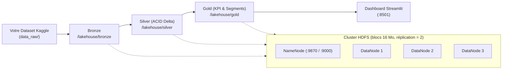

# hadoop-kaggle — TP Big Data Lakehouse — HDFS (3 DataNodes) + PySpark + Delta Lake + Streamlit

Environnement pédagogique complet reposant sur un **cluster HDFS réel distribué (1 NameNode + 3 DataNodes)** avec blocs réduits à **16 Mo** et détection de panne abaissée à **~50 secondes**, couplé à une image mutualisée légère (`python:3.11-slim-bookworm` + `uv` + JARs Delta pré-embarqués) pour **PySpark 3.5**, **Delta Lake 3.2**, **JupyterLab** et **Streamlit**.

Chaque étudiant / groupe **choisit librement sa thématique métier et son dataset public sur Kaggle** pour construire de bout en bout une architecture **Data Lakehouse Médaillon (Bronze → Silver → Gold → Dashboard)**.



---

## Critères de choix de votre Dataset Kaggle

Pour tirer pleinement parti de l'infrastructure distribuée et des exercices statistiques des Jours 1 à 4, choisissez sur [Kaggle Datasets](https://www.kaggle.com/datasets) un jeu de données respectant ces critères :

1. **Volumétrie totale : ~50 Mo à 500 Mo** (avec au moins un fichier dépassant **20 à 32 Mo** afin d'observer physiquement le découpage multi-blocs de **16 Mo** sur HDFS au Jour 1).
2. **Richesse des attributs** :
   - Au moins **une colonne temporelle** (dates / timestamps d'événements) pour les analyses de séries et de croissance (`LAG`).
   - Des **variables quantitatives continues** (montants, durées, distances, consommations, retards...) permettant d'étudier l'asymétrie (médiane vs moyenne, IQR).
   - Des **dimensions catégorielles ou géographiques** (catégories, régions, stations, types...) et idéalement **plusieurs tables joignables** (ou une table de nomenclature pour pratiquer le *Broadcast Join*).
3. **Exemples de domaines possibles** : mobilité urbaine / aérienne, e-commerce & logistique, énergie & capteurs IoT, santé publique, transactions financières, plateformes culturelles / jeux vidéo.

---

## Arborescence du dépôt

```text
.
├── .devcontainer/
│   └── devcontainer.json       # Connexion VS Code directe au conteneur spark-jupyter
├── .vscode/
│   ├── extensions.json         # Extensions recommandées (Python, Jupyter, Ruff, Docker, Task)
│   ├── launch.json             # Débogage PySpark & prévisualisation Streamlit (:8502)
│   ├── settings.json           # Kernel Python/Jupyter pré-configuré, Ruff & propreté éditeur
│   └── tasks.json              # Actions VS Code en 1 clic (Démarrer, Télécharger Kaggle, Crash-test...)
├── docker-compose.yml          # Cluster HDFS (1 NN + 3 DN) + JupyterLab + Streamlit
├── Taskfile.yml                # Orchestration go-task (démarrage, crash-test, tests J1..J4)
├── mise.toml                   # Gestionnaire d'outils (go-task, uv, python 3.11)
├── pyproject.toml              # Dépendances Python compatibles uv
├── config/
│   ├── core-site.xml           # Point d'entrée RPC hdfs://namenode:9000
│   ├── hdfs-site.xml           # Blocs 16 Mo, réplication=2, détection panne ~50s
│   └── spark-defaults.conf     # Pré-configuration automatique HDFS + Delta Lake
├── docker/
│   └── workspace/
│       ├── Dockerfile          # Image légère multi-arch (uv + OpenJDK + cache Ivy Delta)
│       └── requirements.txt    # Dépendances gelées pour le workspace
├── data_raw/                   # Dépôt local de vos fichiers Kaggle avant ingestion HDFS
├── notebooks/                  # Notebooks TP pas-à-pas agnostiques (Jours 1 à 4)
│   ├── J1_HDFS_Ingestion_Bronze.ipynb
│   ├── J2_Spark_Delta_Silver.ipynb
│   ├── J3_Analytics_SQL_Gold.ipynb
│   └── J4_Stats_Segmentation_Dashboard.ipynb
└── app/
    └── dashboard.py            # Squelette Streamlit connecté à /lakehouse/gold/
```

---

## Démarrage rapide

### Avec `mise` et `go-task` (recommandé)

```bash
# 1. Installer automatiquement task (go-task) et uv si absents
mise trust && mise install

# 2. Construire l'image et démarrer tout le cluster (attend la disponibilité des 3 DataNodes)
task up

# 3. Télécharger votre dataset Kaggle choisi dans data_raw/
task data:download DATASET=auteur/nom-du-dataset
```

### Sans `task` (commandes Docker natives)

```bash
docker compose up -d --build
```

---

## Interfaces exposées

| Service | URL | Détails |
|---|---|---|
| **HDFS NameNode UI** | http://localhost:9870 | Onglets *Datanodes* & *Utilities > Browse the file system* |
| **JupyterLab** | http://localhost:8888 | Mot de passe / Token : `bigdata` |
| **Spark Web UI** | http://localhost:4040 | DAG, Stages & Shuffle *(actif dès qu'une `SparkSession` tourne)* |
| **Dashboard Streamlit** | http://localhost:8501 | Lecture des tables Delta de `/lakehouse/gold/` avec cache 60s |

---

## Travailler dans VS Code (Kernel Jupyter & Conteneur pré-configurés)

### Option A — Mode Dev Container intégré *(recommandé : auto-complétion PySpark, Ruff, Git & Kernel en 1 clic)*
1. Ouvrez ce dossier dans VS Code et installez l'extension recommandée **Dev Containers** (`ms-vscode-remote.remote-containers`).
2. Cliquez sur **Reopen in Container** (ou `Ctrl+Shift+P` → `Dev Containers: Reopen in Container`).
3. VS Code vous connecte directement dans `spark-jupyter` (`/workspace`) avec le kernel **`Python 3.11 (PySpark 3.5 + Delta Lake)`**, Pylance, Ruff, `git`, `jq` et `pytest` prêts à l'emploi.

### Option B — Mode Léger depuis l'hôte *(idéal pour les PC portables à 8 Go de RAM)*
1. Lancez `task up`.
2. Ouvrez un notebook dans `notebooks/`, cliquez sur **Select Kernel** → **Existing Jupyter Server...** → `http://localhost:8888/?token=bigdata`.

---

## Programme des Notebooks (`notebooks/`)

1. **`J1_HDFS_Ingestion_Bronze.ipynb` — Cadrage du sujet, HDFS & Tolérance aux pannes**
   - Sélection et téléchargement de votre dataset Kaggle via `kagglehub`.
   - Téléversement sur HDFS, inspection du découpage en **blocs de 16 Mo** et de la **Data Locality** (`1 bloc = 1 partition Spark`).
   - **Crash-test en direct** : arrêt de `datanode2`, détection en ~50s, auto-réplication sur le 3e DataNode et lecture sans interruption.
   - Ingestion vers la couche **Bronze** (`/lakehouse/bronze/`) au format Delta Lake avec métadonnées de traçabilité.
2. **`J2_Spark_Delta_Silver.ipynb` — Nettoyage, Jointures distribuées & Transactions ACID**
   - Profilage qualité, typage fort, dédoublonnage et création d'indicateurs métier propres à votre sujet.
   - Optimisation des jointures (**Broadcast Hash Join** vs SortMergeJoin) et prévention des produits cartésiens N-M.
   - Garanties ACID Delta Lake sur `/lakehouse/silver/` : `_delta_log`, **Schema Enforcement**, **Upsert (`MERGE INTO`)** et **Time Travel (`VERSION AS OF`)**.
3. **`J3_Analytics_SQL_Gold.ipynb` — Spark SQL avancé, Rigueur statistique & Couche Gold**
   - Diagnostic d'asymétrie (`SKEWNESS`) : justification statistique du couple **Médiane (`PERCENTILE_APPROX`) + IQR** face à la moyenne.
   - Fonctions de fenêtrage SQL (`DENSE_RANK`, courbe cumulée de **Pareto**, `ROW_NUMBER`, évolution temporelle `LAG`).
   - Alimentation de vos tables **Gold** (`/lakehouse/gold/`) et compaction `OPTIMIZE`.
4. **`J4_Stats_Segmentation_Dashboard.ipynb` — Tests statistiques, Segmentation & Dashboard**
   - Tests d'hypothèses non-paramétriques (`scipy.stats` : **Mann-Whitney U**, **Kruskal-Wallis**, **Spearman**).
   - Segmentation / typologie non supervisée (**K-Means** avec `log1p` + `StandardScaler`) enregistrée en couche Gold.
   - Restitution décisionnelle interactive et documentée dans `app/dashboard.py` sur `http://localhost:8501`.

---

## Commandes `task` principales (`Taskfile.yml`)

```bash
task up                                  # Démarrer le cluster et attendre les 3 DataNodes + Jupyter + Streamlit
task status                              # État des conteneurs et rapport HDFS (dfsadmin -report)
task data:download DATASET=auteur/slug   # Télécharger votre dataset Kaggle dans data_raw/ via uv
task hdfs:ls                             # Lister l'occupation disque des couches Bronze / Silver / Gold
task hdfs:fsck                           # Inspecter les blocs de 16 Mo et leurs DataNodes hôtes
task hdfs:crash-dn2                      # [TP Jour 1] Couper datanode2 pour observer l'auto-réparation en ~50s
task hdfs:restore-dn2                    # [TP Jour 1] Relancer datanode2
task test:docker                         # Vérifier la santé de HDFS, JupyterLab et Streamlit
task test:notebooks                      # Exécuter et valider vos 4 notebooks (J1 -> J4)
task down                                # Arrêter les conteneurs (conserve les volumes HDFS)
task clean                               # Arrêter et purger les volumes HDFS
```
